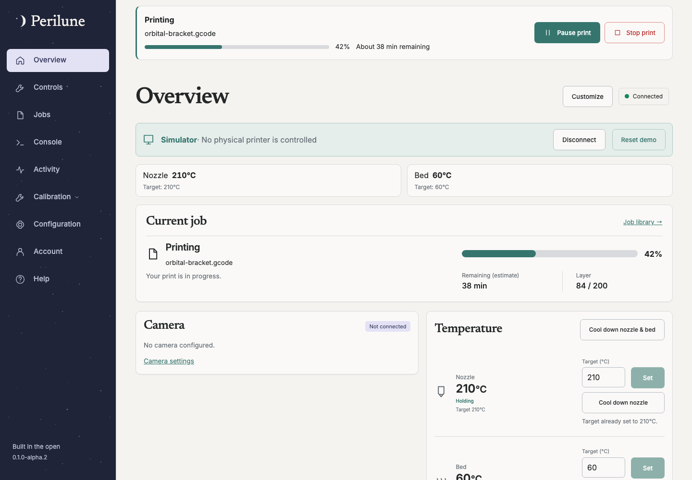

# Perilune

**Your printer, in orbit.** A self-hosted Klipper/Moonraker interface with a
persistent backend, shared printer state and a responsive desktop/mobile UI.
Early alpha—keep your existing interface available while evaluating it.

- Printer progress and controls across pages, retained drafts, and explicit action receipts.
- Authenticated camera video, snapshots and USB MJPEG conversion.
- Jobs, slicer uploads/browser pairing, configuration assistance and guided calibration.
- Passwords, passkeys, invitations, recovery and configurable push notifications.

**[Install Perilune](https://github.com/colecrouter/perilune/wiki/Installation)** · **[Documentation](https://github.com/colecrouter/perilune/wiki)** ·
**[Releases](https://github.com/colecrouter/perilune/releases)** ·
**[Contribute](CONTRIBUTING.md)** · **[Report an issue](https://github.com/colecrouter/perilune/issues)**

Published containers support Linux x86-64 and ARM64. Install bundles pin exact
image digests and include [upgrade/rollback](https://github.com/colecrouter/perilune/wiki/Upgrading) instructions.
Live printer writes require explicit opt-ins and attended testing; commands with
unknown outcomes are never automatically replayed.

For source builds and simulator development, see [development](docs/development.md).
Licensed [GPL-3.0-only](LICENSE).
