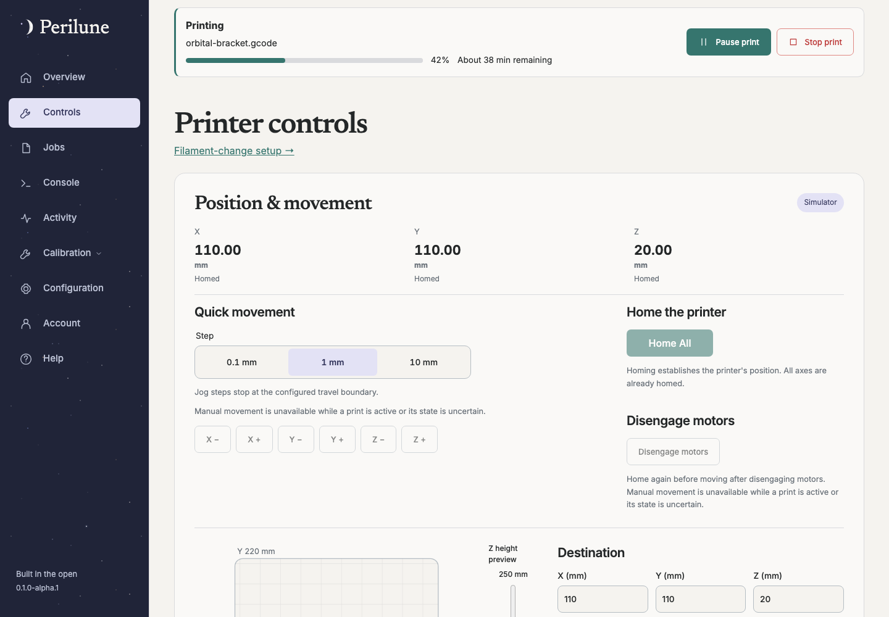
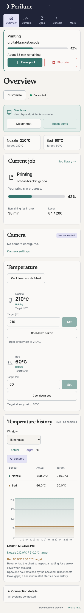

# Perilune documentation

> Release status: alpha.2 changes are **unreleased until** the matching
> `v0.1.0-alpha.2` release is published. Use the alpha.1 guides for alpha.1 installs.

These guides describe **0.1.0-alpha.2**. Use the copy inside an install bundle or
the repository’s matching release tag when running an older version. `main` may
describe unreleased changes. Feature guides name their first public release. The [Wiki](https://github.com/colecrouter/perilune/wiki) is the primary reading location; these matching sources also ship in release bundles.

## Start here

- [Install and connect](getting-started.md): Docker, owner setup, Moonraker, camera and slicer entry points.
- [Upgrade and rollback](upgrading.md): explicit versions, consistent backups and fresh-volume restore.
- [Installation settings](configuration-options.md): origins, secrets, live-workflow gates and camera deployment.
- [Deployment](deployment.md): HTTPS proxy, service layout and off-host backups.

## Use Perilune

Start with [Overview and everyday printing](overview.md).

| Area                                                        | Guide                                                                             |
| ----------------------------------------------------------- | --------------------------------------------------------------------------------- |
| Job library, uploads, OrcaSlicer and browser pairing        | [Jobs and slicers](jobs.md)                                                       |
| Camera sources, quality and local USB                       | [Camera setup](camera-setup.md), [compatibility](camera-compatibility.md)         |
| Physical control opt-ins and recovery                       | [Live controls](live-controls.md), [action receipts](actions.md)                  |
| Configuration drafts, editor assistance and reviewed saving | [Configuration](configuration.md)                                                 |
| Bed mesh, Z and calibration workflows                       | [Bed mesh](bed-mesh.md), [Calibration](calibration.md), [PID](pid-calibration.md) |
| Console, macro history and shortcuts                        | [Console](console.md)                                                             |
| Layout, display and device preferences                      | [Preferences](preferences.md), [Notifications](notifications.md)                  |
| SMTP, email verification and account recovery               | [Email and recovery](account-email.md)                                            |

The in-app **Help** page links to everyday workflows. Screenshots use synthetic
fixtures; no private printer configuration or captured media is published.

## Preview

Phone layout

## Help and acceptance

- [Locks, failures and recovery](recovery.md)
- [Accounts and browser pairing](accounts.md)
- [Filament-change compatibility](filament-changes.md)
- [Alpha acceptance and known limits](acceptance.md)

## Build and maintain

- [Development/source installations](development.md)
- [Contributing](../CONTRIBUTING.md)
- [Release policy and maintainer procedure](releases.md)
- [Architecture and implementation scope](architecture.md)

The Wiki is published from an explicit release tag using the [maintainer procedure](releases.md#wiki-publication).
