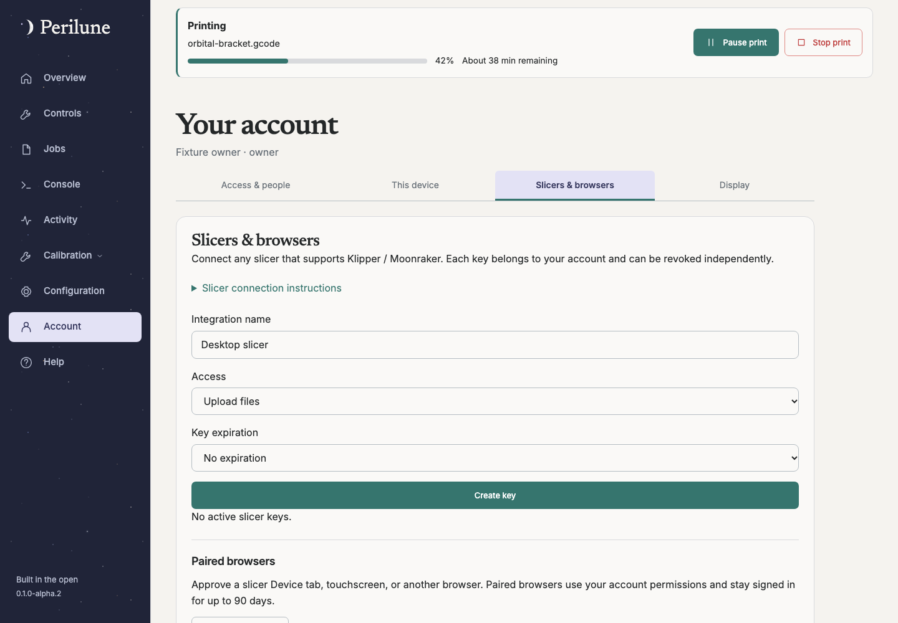

# Accounts, browser pairing and access

> Release status: alpha.2 changes are **unreleased until** the matching
> `v0.1.0-alpha.2` release is published. Use the alpha.1 guides for alpha.1 installs.

Available since **0.1.0-alpha.1**. Early pairing submission was corrected in
**0.1.0-alpha.2**.

The first owner is created through the one-time [installation setup](getting-started.md).
Owners manage accounts, invitations, configuration and host settings. Operators
can use enabled printer controls; viewers observe. Host opt-ins still apply even
to owners. Keep the existing printer interface available during alpha evaluation.

## Sign in and recover

Use a password or an enrolled passkey. Add a passkey from Account on a browser that
supports it, and keep another recovery method available. A browser session lasts
90 days rather than being extended by background traffic. Each device has an
independent session. For SMTP verification, password reset and owner-generated
reset links, follow [Accounts and email](account-email.md).

## Pair a browser that cannot use passkeys

This is useful for a slicer's embedded Device tab or a touchscreen.

1. Open Perilune in that browser and choose **Sign in with another browser**.
2. Request a pairing code and leave the page open.
3. In an already signed-in browser, open the pairing approval page, enter the code
   and review the intended account/device before approving.
4. Return to the waiting browser. It receives its own revocable sign-in session.

Do not approve a code sent by an unknown person. Account → **Slicers & browsers**
contains paired browser management. Revocation affects that browser independently.
The code flow does not grant a slicer upload key; those are separate scoped
credentials described in [Jobs and slicers](jobs.md).

## Invite and manage access

Owners create an invitation with the intended role. Copy the invitation link or
choose email delivery when SMTP is configured. Treat copied invitations and reset
links as credentials: share them privately, revoke unused links and never post
screenshots containing them. Owner-generated reset links provide a fallback when
email delivery is unavailable; they do not prove inbox ownership.
