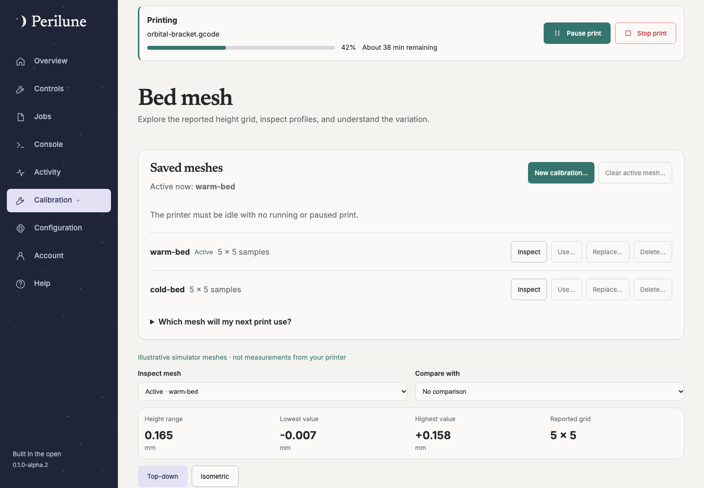
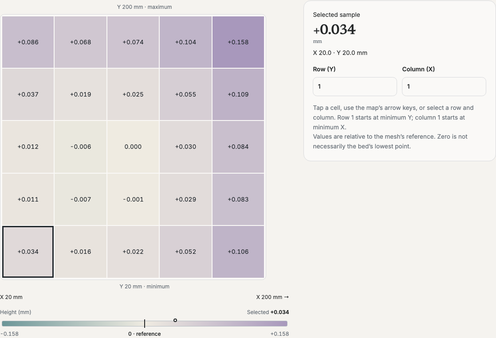

# Bed mesh: inspect, calibrate and save

> Release status: alpha.2 changes are **unreleased until** the matching
> `v0.1.0-alpha.2` release is published. Use the alpha.1 guides for alpha.1 installs.

Available since **0.1.0-alpha.1**. Interrupted candidate-less recovery was corrected
in **0.1.0-alpha.2**. The image below uses synthetic simulator measurements.

## Inspect without changing the printer

Open **Calibration → Bed mesh**. Selecting a saved mesh for visualization does
not activate it. Inspect the map, individual samples or the numeric table. Colors
share a zero-centered scale.

 Comparison means selected minus reference and requires
matching sample coordinates. Shape is useful context, not a print-quality verdict.

## New calibration or replacement

- **New calibration…** creates a new result. Preparation does not ask you which
  saved mesh to replace. After probing, choose a unique name when saving.
- **Replace…** on a saved mesh opens preparation for exactly that target. Accepting
  updates that saved mesh; it does not ask for another destination or create a
  series of permanent copies.
- **Usual mesh** is the friendly label for Klipper's `default` profile. Existing
  print-start macros that load `default` retain that identifier.

Review probing bounds, clear the bed and inspect the probe/nozzle. The current
live workflow is cold rectangular probing with discrete probes: heater targets
must be off and measured bed/nozzle temperatures at most 40°C. The host must enable
`PERILUNE_LIVE_MESH=true`. Homing occurs if needed. Leaving the page does not stop
the backend-owned operation. Progress is also visible in the shared workflow notice.

## Review the result

Klipper activates a completed result immediately. Saving writes the reviewed
pending configuration and restarts Klipper. New results need a unique public
profile name; replacement retains its selected destination. Unexpected pending
settings or changed configuration block automatic saving or discard.

Discard restores the saved baseline, restarting Klipper without saving when
needed, then restores the previously active saved compensation (or clears it if
none was active). This is an explicit operation, not an undo in the browser.
If firmware was already restarted after an interrupted probe, alpha.2 can verify
the captured baseline and restore compensation without repeating that restart.
See [recovery](recovery.md) if the outcome is uncertain.

## Activate or delete saved meshes

A saved mesh and active compensation are separate. Use the explicit activation
control to load a saved mesh; **Clear active mesh** disables current compensation
without deleting saved data. Deleting requires confirmation and, on a live printer,
reviewed persistence plus restart. The active mesh cannot be deleted; clear or replace it first. Detected macro
references block live deletion. Review print-start dependencies yourself as well,
since dynamic references cannot be inferred reliably.

Saving or loading does not edit your print-start macro. Klipper does not guarantee
that a saved `default` is loaded automatically at startup. Review the procedure
that starts each print: [Klipper mesh loading](https://www.klipper3d.org/Bed_Mesh.html#loading-the-default-profile).

Repeated replacements reuse their target. New calibrations create a permanent
profile only when explicitly saved under a new name; internal run profiles are
workflow state rather than an expanding permanent library.
