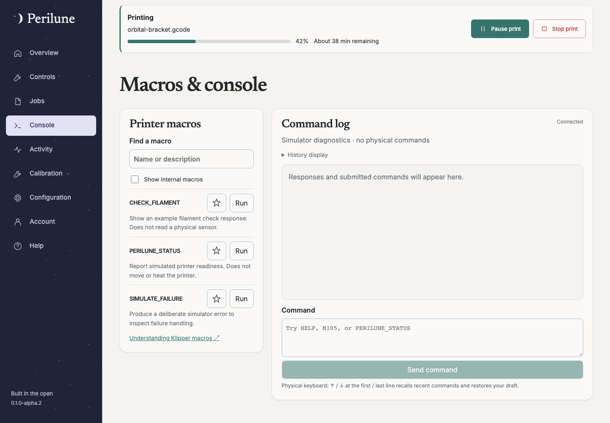

# Macros and console

Available since **0.1.0-alpha.1**. This guide describes **0.1.0-alpha.2**.

Open **Console** for macro discovery, shortcuts, command history and printer
responses. Operator or owner access is required: output may include private
filenames, diagnostics or values printed by your own macros. Viewers retain the
ordinary dashboard but cannot read or submit console activity.

## Simulator

The console runs diagnostic examples only: `M105`, `M114`, `HELP`,
`PERILUNE_STATUS`, `CHECK_FILAMENT` and `SIMULATE_FAILURE`. The last command
intentionally demonstrates an error. No console example moves or heats anything;
unsupported commands fail clearly instead of pretending to execute. These
read-only examples can run during a simulated print, but calibration/configuration
ownership, pending printer controls, disconnects and storage problems block them.

Type up to eight lines/2,048 characters and choose **Send command**. The explicit
submission runs the script once; there is no additional review dialog. A macro’s
**Run** button submits it directly while preserving an unrelated command draft.
Read the inline live-printer warning and check the macro configuration before sending.
Pending and unknown outcomes still block another submission until reconciled.

Receipts show queued, sending, completed, failed or unknown. Execution belongs to
the backend and continues through navigation. Inputs remain intact through incoming
state updates and reconnects. If submission acknowledgement is lost, **Check receipt**
looks up its existing ID without sending again. **Stop tracking…** only stops local
tracking; it does not cancel or retry the command. Check history before a deliberate
new submission. Unknown results are never automatically replayed.

## Live printers

Perilune discovers loaded macro names and help descriptions through its existing
Moonraker connection. Optional help failures do not interrupt printer telemetry.
No macro bodies or guessed parameters are loaded. Missing descriptions link back
to macro/configuration documentation. Existing G-code responses are collected even
when all browser tabs are closed; they may originate from another printer client.
They are not attributed to an unverified Perilune request.

Set both `PERILUNE_LIVE_CONTROLS=true` and `PERILUNE_LIVE_CONSOLE=true` to enable reviewed console/macros. This is a separate opt-in because arbitrary scripts can move or heat the printer and macros may have additional side effects. Review their configuration; Perilune does not infer macro bodies or parameter meaning. Keep other controllers idle.

Execution requires a fresh ready, idle printer without another action/calibration/configuration/recovery. It enters the same process-owned durable live action worker, shared admission, safety epoch and unknown-outcome recovery as basic controls. The console receipt follows that action, including navigation and backend restart; acknowledgement loss never resends it. A motion barrier is appended. Completed means Klipper acknowledged the script/barrier and fresh ready state was observed, not proof of every macro-specific effect. Inspect corresponding telemetry and responses.

Direct lifecycle commands for job start/pause/resume/cancel, probing, SAVE_CONFIG and restarts are refused; use their dedicated flows. Emergency G-code remains forbidden and uses the independent emergency endpoint instead. This text check cannot inspect commands invoked inside user-defined macros. A macro that restarts, starts a helper or changes readiness can produce unknown recovery rather than verified completion.

## Retention

The visible shared log contains the latest 100 command receipts and 200 live
responses. Receipts persist in the private SQLite database, retained for up to seven
days/2,000 records with periodic cleanup. Live responses are bounded in process
memory and clear on backend restart. Reconnects retain the current process log.
Queued/sending commands become unknown on restart and are never resumed. A maximum
of 20 submissions may be pending; queued commands expire after 30 seconds. Shortcuts
are limited to 24 per account. Exporting or durable external log collection is not
implemented in this milestone.

Console interaction details:

- Up/Down at the first/last input line recalls distinct recent submitted commands. Returning past the newest command restores the unfinished draft; editing a recalled command starts a new draft. History is frozen while browsing so incoming commands do not shift the selection.
- “Group repeated responses” combines adjacent identical responses or adjacent temperature reports with gaps of at most 30 seconds. Expand a group to see every original sample and timestamp, or disable grouping. Commands and differing probe samples remain separate; grouping never changes retained backend data.

## Reading retained output

Follow latest responds to actual log activity rather than ordinary printer-state
refreshes. Scrolling up or expanding grouped responses pauses following. Use the
sticky **Collapse messages** button from within a long group, or its summary, to
collapse it. Re-enable **Follow latest** explicitly to jump back to the newest output.
Grouping only affects display; original responses and submission receipts are retained.
