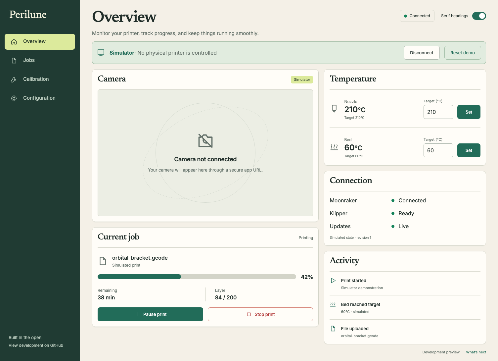

# Initial visual direction

`overview-concept.png` is the initial concept generated with the built-in Image Gen
tool. It is a design reference, not an application asset. The brief requested a
full Perilune dashboard, warm off-white/graphite/teal palette, restrained serif
headings, accessible sans-serif controls, left navigation, simulator strip, camera
empty state, job controls, temperatures, connection state, and activity.

Serif headings are the chosen direction. The running dashboard retains a serif toggle for comparing Newsreader headings
with Inter. Fonts are self-hosted. System light/dark appearance is supported.

Intentional deviations from the concept:

- Navigation links for planned workflows lead to an explicit roadmap.
- Status is text, not a dropdown without a defined behavior.
- Activity becomes real simulator action history after the first command.
- A small revision indicator helps verify live state during initial development.
- Icons are code-native, consistent outlines. The favicon is a simple vector crescent.
- Camera content remains an honest empty state until actual media integration.
- Mobile uses a compact horizontal navigation and stacked panels.

Production smoke creates desktop serif/sans, stop dialog, and mobile light/dark
screenshots under `test-results/`, also uploaded by CI for review.

## Initial review evidence

[Sans-serif comparison](overview-sans.png) · [Mobile](overview-mobile.png) ·
[Mobile dark](overview-mobile-dark.png) · [Stop dialog](stop-print.png)

The initial concept and browser captures were inspected with `view_image` at the
concept's 1505 × 1045 viewport and a 390 × 844 mobile viewport. T3 preview was used
first, then explicitly reported its automation host unavailable; headless
Playwright provided the production captures.

Comparison ledger:

| Area       | Result                                                                                                                 |
| ---------- | ---------------------------------------------------------------------------------------------------------------------- |
| Layout     | Left rail, simulator strip, camera/job left and controls/status right retained. Mobile stacks without overflow.        |
| Palette    | Warm off-white, graphite, teal, neutral camera frame; no decorative image overlays.                                    |
| Typography | Newsreader heading and Inter controls; alternative sans heading is implemented for review.                             |
| Controls   | Distinct stop treatment, target labels/units, pending states, clear connection indicators.                             |
| Media      | Honest camera empty state matches the concept; no fake printer footage.                                                |
| Copy       | Main overview, camera, job, heater, and connection labels retained; simulator/history/roadmap deviations listed above. |

The initial concept established the structure. Following user feedback, the next
iteration extends serif typography to section headings and adds a deep green rail,
lime selections, stronger borders, warmer surfaces, and subtle orbital linework.
These are intentional refinements to the accepted direction. The screenshots above
show the current implementation, while `overview-concept.png` preserves the initial
reference. T3 preview and production captures were checked for desktop/mobile
layout, typography, palette, control states, and overflow. Mobile aspect-ratio
and grid minimum widths were repaired after the smoke test caught overflow.
