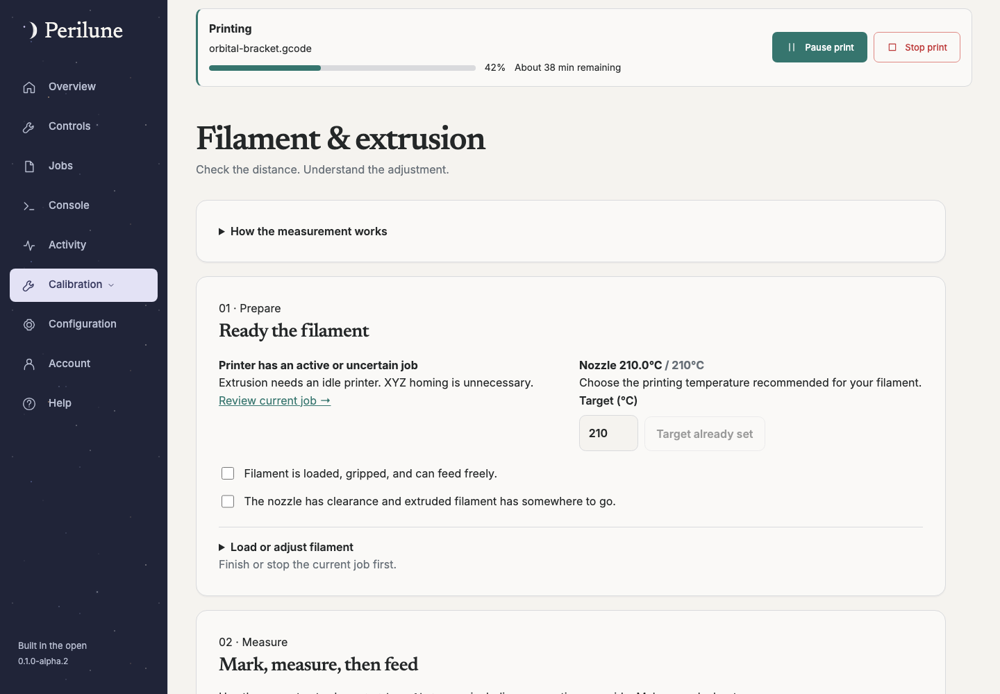

# Filament changes and compatibility

Available since **0.1.0-alpha.1**.

A command named `M600` is not a universal Klipper implementation. Printers may
provide their own macros with different parking, retracting and resume behavior.
Perilune discovers available commands and lets an owner review a setup plan instead
of assuming that a name proves compatibility.

Open the filament-change setup in **Calibration → Filament & extrusion**. Review
the detected macros and choose either the printer's reviewed method or attended
assisted handling where supported. Acknowledgement is bound to the selected macro
content; changing that content invalidates the earlier review. Saving a plan does
not install a macro, validate its physical behavior or authorize an automatic move.

During an actual paused print, use the shared filament-change guidance to follow
the selected method. The backend retains the session through page navigation.
Assisted extrusion requires the separate live filament opt-in, appropriate
extruder temperature, bounded distances and owner-coordinated acceptance. Review
parking/clearance and the printer's resume behavior before using real filament.

The Jobs start review lists recognizable M600/pause locations from text G-code.
It does not execute templates, discover pauses hidden in macros or guarantee that
the printer will handle them safely. See [Jobs](jobs.md#planned-manual-interventions),
[Console](console.md) and [live controls](live-controls.md).
