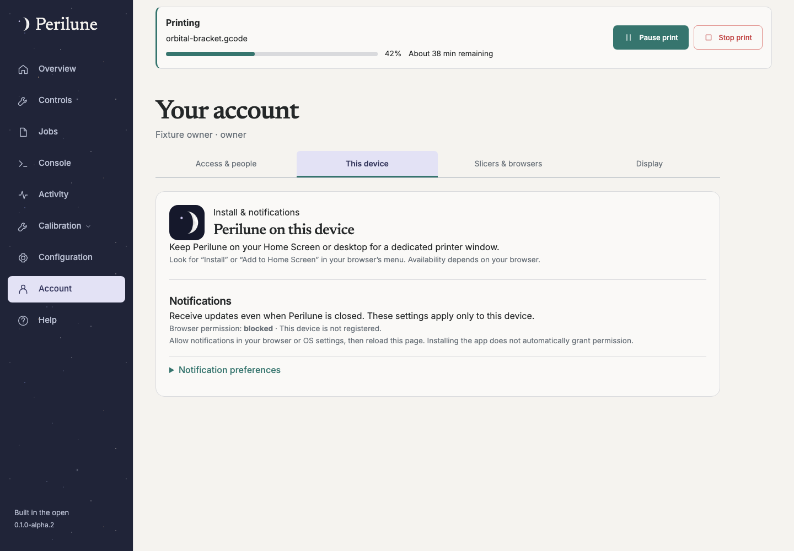

# Install the app and configure notifications

Available since **0.1.0-alpha.1**. Screenshots show synthetic local data.

Open Perilune over HTTPS and use the browser's install/add-to-home-screen feature.
On iPhone/iPad, install to the Home Screen before enabling web push. Exact browser
menus and platform capabilities vary; installation alone does not grant notification
permission or configure delivery.

1. Open **Account → This device** on each device that should receive alerts.
2. Grant notification permission when prompted, enable the desired events and
   configure quiet hours/delivery preferences.
3. Send a test notification and verify it on that device. If permission is denied,
   adjust the site's permission in the browser/OS settings, then return here.
4. Test with the app closed as a separate acceptance check. A test accepted by a
   push service does not prove that an operating system displayed it.

Push registrations and delivery choices are device-specific. Account display and
layout preferences are separate and synchronize across devices. Where configured
and available, event notifications can include a camera image; expired/signed-out
image access falls back rather than exposing unauthenticated media.

An available app update offers an explicit reload. **Later** preserves the current
page and drafts; other tabs are not forcibly reloaded. Finish or save important
work before accepting reload. The service worker does not permanently cache live
printer state or authenticated configuration.

Owner acceptance has confirmed small-print notifications with camera images on
two devices. Remaining platform cases are recorded in the [alpha checklist](acceptance.md).

## Sender compatibility (unreleased)

The server uses pinned `web-push-browser` with a small reviewed compatibility patch.
Existing VAPID keys, registered subscriptions and device preferences retain their
storage format; upgrading does not rotate keys or require re-enabling notifications.
The sender keeps the five-minute TTL and normal urgency, aborts requests after eight
seconds or process-work cancellation, refuses redirects and removes expired
subscriptions on HTTP 404/410. Delivery claims remain durable and ambiguous sends
are not automatically repeated.

Synthetic protocol tests verify signed VAPID claims and independently decrypt the
actual AES128GCM wire payload. These tests do not establish OS display, app-closed
delivery or renewed phone/platform acceptance; keep using the test notification and
remaining device checklist after an upgrade.
